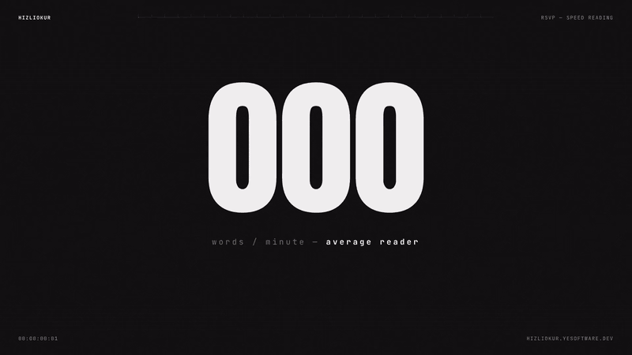
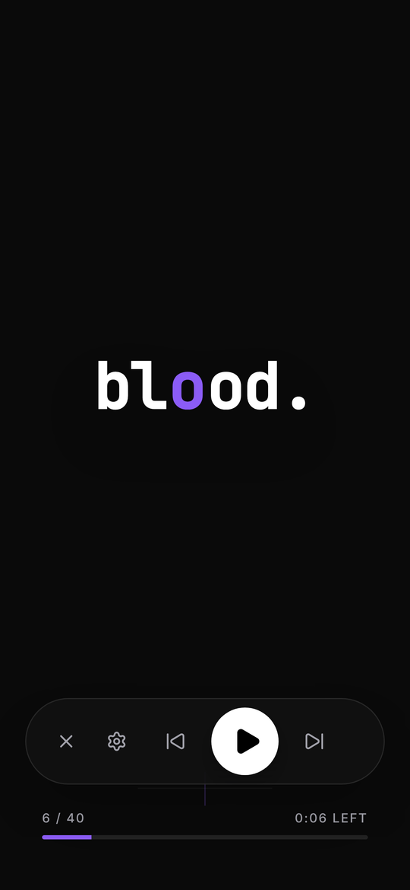
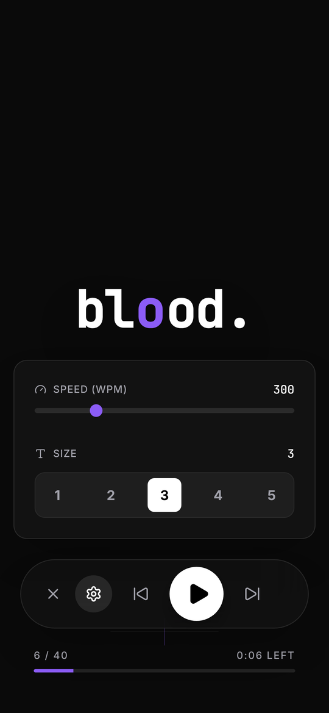
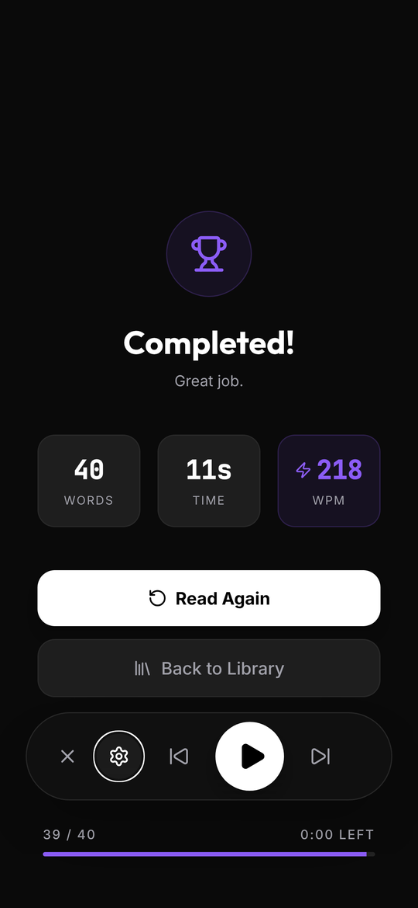
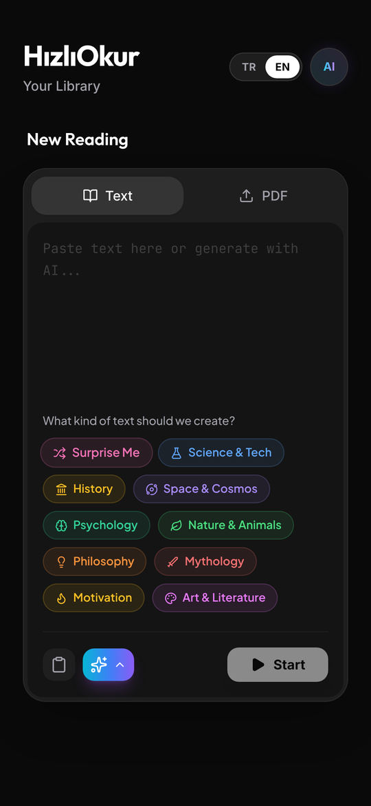
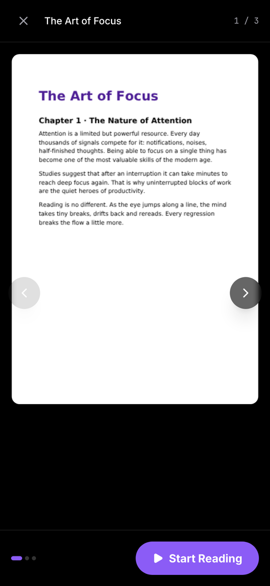
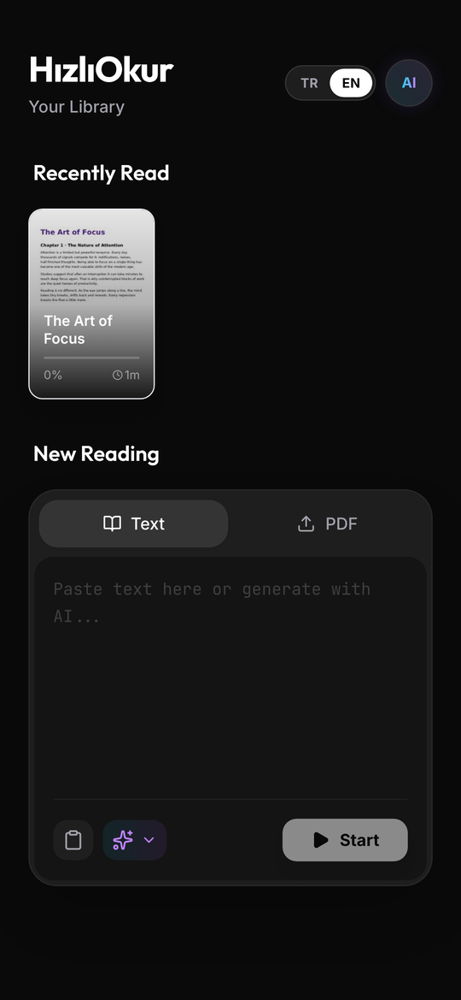

<div align="center">


# HızlıOkur

### Read faster. The words come to you.

A mobile-first **RSVP speed-reading** web app. Paste text, drop in a PDF or let AI write a practice text,
then read one word at a time at up to **1000 WPM**, with the optimal recognition point highlighted.

<a href="https://hizliokur.yesoftware.dev"></a>

<a href="https://react.dev"></a>
<a href="https://www.typescriptlang.org"></a>
<a href="https://vitejs.dev"></a>
<a href="https://tailwindcss.com"></a>
<a href="https://openrouter.ai"></a>


<br /><br />

<a href="docs/demo/hizliokur-demo.mp4">
  
</a>

<sub>▶ Watch the promo with sound (26 s, 1080p): <a href="docs/demo/hizliokur-demo.mp4"><code>16:9</code></a> · <a href="docs/demo/hizliokur-short.mp4"><code>9:16 Shorts / Reels</code></a></sub>

<br />

[Features](#features) · [Screenshots](#screenshots) · [How it works](#how-it-works) · [Getting started](#getting-started) · [Deployment](#deployment)

</div>

---

## Why HızlıOkur?

When you read a line of text, your eyes don't glide. They **jump**, stop, and often jump back. Those jumps (saccades) and regressions cost time.

HızlıOkur uses **Rapid Serial Visual Presentation (RSVP)**: every word appears at the same spot, so your eyes stay still and your mind does the reading. The **optimal recognition point (ORP)** of each word is highlighted in purple, which gives your eyes an anchor.

<table>
  <tr>
    <td align="center" width="25%"><h3>100–1000</h3>words per minute,<br />adjustable while reading</td>
    <td align="center" width="25%"><h3>3 ways</h3>to get text:<br />paste, PDF or AI</td>
    <td align="center" width="25%"><h3>2 languages</h3>UI and AI texts in<br />English and Turkish</td>
    <td align="center" width="25%"><h3>0 sign-ups</h3>progress and settings<br />stay on your device</td>
  </tr>
</table>

## Features

| | |
| --- | --- |
| ⚡ **RSVP reader** | Words flow at a fixed focal point at the speed you choose. |
| 🎯 **ORP highlight** | The pivot letter of every word is highlighted so your eyes have an anchor. |
| ⏸️ **Smart pacing** | Commas, sentence ends and long words get a little more time automatically. |
| 📄 **PDF support** | Text extraction, page previews and "start from page N". |
| ✨ **AI practice texts** | Ten topics (science, history, space, psychology…) generated through [OpenRouter](https://openrouter.ai). |
| 📚 **Library** | Your last 5 books with cover thumbnails and reading progress. |
| 🏁 **Session recap** | Words read, time spent and your actual speed when you finish. |
| ⌨️ **Keyboard shortcuts** | Play, pause and skip without touching the mouse. |
| 🌍 **English / Türkçe** | Switch the whole UI, and the AI texts, with one tap. |
| 🌙 **Dark, mobile-first UI** | A pure-black interface built for phones first, with an onboarding tour on first launch. |

## Screenshots

<table>
  <tr>
    <td align="center"><br /><sub><b>Reader</b>: one word, one spot</sub></td>
    <td align="center"><br /><sub><b>Settings</b>: speed and font size while reading</sub></td>
    <td align="center"><br /><sub><b>Recap</b>: words, time and WPM</sub></td>
  </tr>
  <tr>
    <td align="center"><br /><sub><b>AI texts</b>: pick a topic</sub></td>
    <td align="center"><br /><sub><b>PDF</b>: preview pages and start anywhere</sub></td>
    <td align="center"><br /><sub><b>Library</b>: pick up where you left off</sub></td>
  </tr>
</table>

## How it works

1. **Split.** The text is split into words on whitespace (`utils/rsvpUtils.ts`).
2. **Find the pivot.** Each word gets a pivot letter based on its length:

   | Word length | 1 | 2–5 | 6–9 | 10–13 | 14+ |
   | --- | :-: | :-: | :-: | :-: | :-: |
   | Pivot letter | 1st | 2nd | 3rd | 4th | 5th |

   For example: w**o**rd · re**a**ding · con**c**entration.

3. **Time it.** Each word is shown for `60000 / WPM` ms, multiplied by:
   - **×1.5** after a comma or semicolon
   - **×2** at the end of a sentence (`.` `!` `?`)
   - **×1.2** for words longer than 8 characters
4. **Remember it.** For PDFs, the word index where each page starts is stored, so you can resume from any page in the preview.

## Keyboard shortcuts

| Key | Action |
| --- | --- |
| <kbd>Space</kbd> | Play / pause |
| <kbd>←</kbd> | Back 10 words |
| <kbd>→</kbd> | Forward 10 words |
| <kbd>Esc</kbd> | Leave the reader |

## Tech stack

| Layer | Technology |
| --- | --- |
| UI | React 19 + TypeScript |
| Build | Vite 6 |
| Styling | Tailwind CSS (Play CDN, configured in `index.html`) |
| PDF | `pdfjs-dist` (worker loaded from unpkg) |
| AI | [OpenRouter](https://openrouter.ai) chat completions |
| Storage | `localStorage` (books, settings) + IndexedDB (PDF files) |
| Icons | `lucide-react` |
| i18n | Built-in EN/TR dictionaries (`i18n/`) |

## Getting started

**Requirements:** [Node.js](https://nodejs.org/) 18+ and, for AI texts only, an [OpenRouter API key](https://openrouter.ai/keys).

```bash
git clone https://github.com/Yemresalcan/hizliokur.git
```

```bash
cd hizliokur && npm install
```

```bash
cp .env.example .env
```

Put your key in `.env` (`OPENROUTER_API_KEY=sk-or-v1-...`), then start the dev server:

```bash
npm run dev
```

The app runs at [http://localhost:3000](http://localhost:3000).

> [!TIP]
> Without a key, everything except AI generation still works: pasting text, PDFs, the reader and the library.

| Script | What it does |
| --- | --- |
| `npm run dev` | Start the dev server on port 3000 |
| `npm run build` | Build for production into `dist/` |
| `npm run preview` | Preview the production build |

### Environment variables

| Variable | Required | Description |
| --- | --- | --- |
| `OPENROUTER_API_KEY` | For AI texts | Your OpenRouter API key |

The model is set in `constants.ts` (`MODELS.textGeneration`). By default it is a free model on OpenRouter.

> [!WARNING]
> Vite inlines the key into the client bundle at build time, so anyone can see it in the browser. Use a separate key with a spending limit.

## Deployment

HızlıOkur is deployed on [Vercel](https://vercel.com) and served at **[hizliokur.yesoftware.dev](https://hizliokur.yesoftware.dev)**.

1. Import the repository in Vercel. The Vite preset works out of the box.
2. Add `OPENROUTER_API_KEY` under **Project → Settings → Environment Variables** and redeploy.
3. Add the custom domain under **Project → Settings → Domains**, then create the DNS record Vercel shows (a `CNAME` for `hizliokur`) at the DNS provider of `yesoftware.dev`.

<details>
<summary><b>Project structure</b></summary>

```text
├── App.tsx                 # App state, reading loop, keyboard shortcuts
├── constants.ts            # WPM limits, AI model, storage limits
├── types.ts
├── index.html              # Tailwind CDN config and fonts
├── components/
│   ├── ReaderDisplay.tsx   # Word display with ORP highlight
│   ├── Controls.tsx        # Play, skip, WPM and font size
│   ├── TextInput.tsx       # Text, PDF, AI panel and library
│   ├── PdfPageViewer.tsx   # PDF page preview
│   ├── CompletionScreen.tsx
│   ├── Onboarding.tsx
│   └── Toast.tsx
├── services/
│   ├── openRouterService.ts
│   ├── storageService.ts   # Books (localStorage)
│   └── indexedDbService.ts # PDF files (IndexedDB)
├── utils/
│   ├── rsvpUtils.ts        # Word splitting, ORP, timing
│   ├── pdfUtils.ts         # Text extraction and thumbnails
│   └── toast.ts
├── i18n/                   # EN/TR translations and context
├── public/                 # Logo and onboarding images
└── docs/
    ├── demo/               # Promo videos (16:9 and 9:16) and GIF
    ├── screenshots/        # README screenshots
    └── plans/              # Flutter mobile app plan
```

</details>

## Roadmap

- [x] RSVP reader with ORP highlighting
- [x] PDF import with page previews
- [x] AI practice texts in English and Turkish
- [ ] Native Android and iOS apps with Flutter ([design](docs/plans/2026-02-25-flutter-mobile-app-design.md), [plan](docs/plans/2026-02-25-flutter-mobile-app-plan.md))

---

<div align="center">

Built by **Yunus Emre Salcan** · [yesoftware.dev](https://yesoftware.dev) · [yunusemresalcan.com](https://www.yunusemresalcan.com) · [GitHub](https://github.com/Yemresalcan)

<sub>HızlıOkur: less eye movement, more reading.</sub>

</div>
